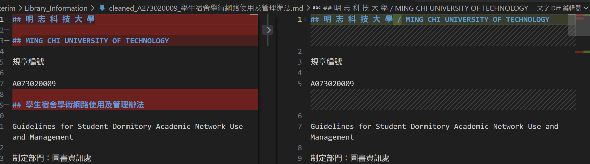
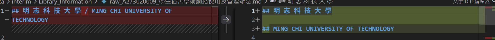
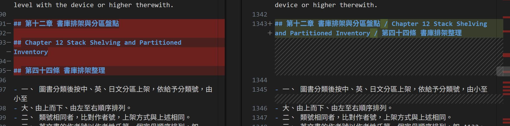

# 資料前處理報告 (Data Preparation Report)

- **學號 / 姓名**：張威得
- **專案名稱**：資料輸入與前處理流程、指定 chunk 產生器
- **完成的任務**：- [✔] 1-A 頁首頁尾清除　- [✔] 1-B 雙語標題合併　- [✔] 1-C 雙語條文合併

---

## 1. 資料集概覽 (Dataset Overview)

| 類別 (Cluster) | PDF 數量 | 清洗前 chunk 數 | 清洗後 chunk 數 |
Academic_Affairs	    3	        96	            64
Library_Information	  3	        248	            209
Student_Affairs	      3	        66	            54
合計	                 9	      410	            327

**問題 (2–3 句)：** 清洗後 chunk 數量變少了多少？是哪個任務造成的？有沒有哪個任務**不影響** chunk 數量？為什麼？

清洗後的 chunk 數量從 410 個減少至 327 個，共減少 83 個，主要是任務 1-B，因為原本分開的中英文標題合併成同一行，減少了切割邊界。
任務 1-C不影響 chunk 數量，因為 chunking_regex = r'\n(?=##\s)' 只會依照 ## 標題切割，不會依照 - 開頭的條文切割。

## 2. 清洗步驟 (Cleaning Steps)

### 2.1 任務 1-A：頁首頁尾溢出清除

- 檔名：cleaned_A273020009_學生宿舍學術網路使用及管理辦法.md　搜尋的文字：學生宿舍學術網路使用及管理辦法
- 截圖 (存為 `reports/figures/1a_compare.png`)：
- 改變了什麼：清洗後移除了原本獨立存在的中文文件標題。
- 這對之後的問答檢索有什麼幫助：除重複或不必要的頁首頁尾文字，可以減少檢索時的雜訊，讓系統更容易找到與問題相關的內容。
- 這個任務有沒有**改錯**的地方 (把不該改的也改了)？若有，寫出檔名與搜尋的文字；若沒有，寫「沒有發現」：有。搜尋 學生宿舍學術網路使用及管理辦法 時，發現原本的中文文件標題也被移除。這是文件的重要資訊，不應被當成頁首頁尾雜訊刪除。

### 2.2 任務 1-B：雙語標題合併

- 檔名：cleaned_A273020009_學生宿舍學術網路使用及管理辦法.md　搜尋的文字：MING CHI UNIVERSITY OF TECHNOLOGY
- 截圖 (存為 `reports/figures/1b_compare.png`)：
- 改變了什麼：原本分開的中文校名與英文校名，在清洗後合併成同一個標題；目錄中的中文與英文標題也由分開變成合併呈現。
- 這對之後的問答檢索有什麼幫助：將中英文標題合併，可以讓系統更完整地辨識標題資訊，降低同一個標題被拆成不同段落的情況，提升文件檢索的完整性。
- 這個任務有沒有**改錯**的地方 (把不該改的也改了)？若有，寫出檔名與搜尋的文字；若沒有，寫「沒有發現」：沒有發現

### 2.3 任務 1-C：雙語條文合併

- 檔名：cleaned_A271010023_圖書館管理作業規範.md　搜尋的文字：書庫排架分區盤點
- 截圖 (存為 `reports/figures/1c_compare.png`)：
- 改變了什麼：中英被合併了
- 這對之後的問答檢索有什麼幫助：將原本分開的中文條文與英文對應條文，整理成同一個條文區塊，方便後續搜尋與閱讀。
- 這個任務有沒有**改錯**的地方 (把不該改的也改了)？若有，寫出檔名與搜尋的文字；若沒有，寫「沒有發現」：沒有發現

## 3. 評估指標與 AI 解讀查證 (Metrics & Verifying the AI's Interpretation)

### 3.1 指標數據表

| 指標 | Raw | Cleaned (你的) | Cleaned (參考值) |
|---|---|---|---|
| [1] 中位數長度 Median Length |205 |297 |270.5 |
| [2] 拓撲錨定率 TAR |1 |1 |1 |
| [3] 深度變異量 SDV (選填) |0 |0 | 0|
| [4] 中位數資訊熵 Entropy (選填) |4.72 |5.1381 |5.06232 |

你的 Cleaned 結果與參考值一致嗎？若一致，寫「一致」；若不一致，找出原因。（1 句）

可能是資料清洗方式、文字區塊切分或合併結果不同所造成。

### 3.2 AI 的解讀
- 使用的 AI 工具：gemini

這張圖片展示了 Data Ingestion Empirical Evaluation（資料攝取實證評估） 的實驗結果，透過四個不同的圖表來對比經清理（Cleaned）與原始（Raw）資料的各項指標。   以下是這四個圖表的詳細解釋：
[1] Morphological Viability (Log Scale) / 形態可行性類型：對數刻度的盒鬚圖（Box Plot）。   說明：比較「Cleaned」與「Raw」資料在型態可行性上的分佈。兩者的中位數和分佈範圍大致相似，但 Raw 資料的上界延伸至更高數值，且包含較多極端離群值。
[2] Topological Anchoring Ratio (TAR) / 拓撲錨定率類型：長條圖。   說明：顯示 Cleaned（綠色）與 Raw（紅色）資料的拓撲錨定率。兩者皆達到 1.0 的滿分，表示在維持結構錨定方面表現一致。
[3] Cleaned vs. Raw Structural Depth / 結構深度對比類型：長條圖。   說明：比較區塊數量（Number of Chunks）。圖中顯示 Raw（橘色） 的區塊數量約為 410，顯著高於 Cleaned（藍色） 的約 325。這意味著清理後的資料減少了冗餘或不必要的區塊。
[4] Shannon Information Entropy / 夏農資訊熵 (High is good)   類型：盒鬚圖。   說明：評估資料的資訊豐富程度（數值越高越好）。Cleaned 與 Raw 資料的分佈相近，中位數皆落在 5 左右，且四分位距與上下鬚線的範圍也十分接近，顯示清理過程大致保留了原有的資訊熵。

### 3.3 你的查證 (至少兩點)

**查證 1**
- AI 的說法：Cleaned 與 Raw 的拓撲錨定率（TAR）皆達到 1.0，表示兩者在維持結構錨定方面表現一致。
- 我查了什麼 (哪個檔案、哪個 chunk、哪段程式)：專案根目錄的 metrics.json，查看 Topology_TAR_Score 欄位。
- 結論：正確 

**查證 2**
- AI 的說法：Raw 的區塊數量約為 410，明顯高於 Cleaned 的約 325，表示清理後減少了冗餘或不必要的區塊。
- 我查了什麼：01_Data_Ingestion.ipynb 第 6 節的儀表板，以及產生 Raw 和 Cleaned 資料的程式。
- 結論：部分正確，因為儀表板確實顯示 Raw 的區塊數量較多，但區塊數量減少不一定代表都是冗餘內容，也可能是清洗時合併了原本分開的文字區塊。

### 3.4 實際證據：你被指定的 chunk

- **SEED**：1106

**(a) 很長的 chunk**
- 資料檔 (JSON)：cleaned_A232020018_大學部學則_processed.json　位置：第 9 個 (從 0 開始數)　長度：7305 字元　
  驗證碼：fcc71219
- 閱讀用檔案 (`.md`)：cleaned_A232020018_大學部學則_processed.md從第 531 行開始
- 前 3 行內容：
  ```text
  （## 第四章 請假、休學、復學、退學 / Chapter 4 Excused Absences Leaves of Absence (Suspension), Resumption of Studies, and Withdrawal

- 第四十三條 學生因故不能上課，須依照請假規則辦理請假，經核准請假者為缺課（公假除外），未請假或請假未准而未上課者為曠課。「學生請假作業辦法」另訂之。
- Article 43 Students who are unable to attend class are required to request a leave in accordance with the Regulations Governing Student Leave Requests.
  ```
- 這是什麼樣的文字？為什麼會這麼長？這是一段大學部學則中關於請假、休學、復學及退學的規定，包含多個條文及中英文內容，因此累積成較長的文字區塊。
- 之後做問答檢索時，這麼長的 chunk 可能造成什麼問題？內容包含多個不同規定，可能讓檢索結果不夠精準，也可能使 AI 在回答特定問題時混入其他條文的資訊。

**(b) 資訊熵很低的 chunk**
- 資料檔 (JSON)：cleaned_A271010023_圖書館管理作業規範_processed.json位置：第 149 個 (從 0 開始數)　資訊熵：3.14　驗證碼：c9bc9f6f
- 閱讀用檔案 (`.md`)：cleaned_A271010023_圖書館管理作業規範.md　從第 1824 行開始
- 內容：
  ```text
  |              | Sort 5       |                                                   |                                                 |                                                 |                                              28 |                                              40 |                                              45 |                                              47 |                                              47 | 46                                               |                                               45 |                                                  |                                          43 |                                               42 |                                               40 |                                             38.5 |
|              | 6            |                                                   |                                                 |                                                 |                                                 |                                              20 |                                              30 |                                              35 |                                              37 | 38                                               |                                               38 |                                                  |                                          38 |                                               37 |                                               36 |                                               35 |
|              | Sequence 7   |                                                   |                                                 |                                                 |                                                 |                                                 |                                              15 |                                              23 |                                              28 | 31                                               |                                               32 |                                                  |                                          32 |                                               32 |                                               32 |                                             31.5 |
|              | of 8         |                                                   |                                                 |                                                 |                                                 |                                                 |                                                 |                                              12 |                                              19 | 23                                               |                                               25 |                                                  |                                          27 |                                               28 |                                               28 |                                               28 |
|              | Y 9          |                                                   |                                                 |                                                 |                                                 |                                                 |                                                 |                                                 |                                               9 | 15                                               |                                               19 |                                               22 |                                          23 |                                                  |                                               24 |                                             24.5 |
|              | Database 10  |                                                   |                                                 |                                                 |                                                 |                                                 |                                                 |                                                 |                                                 | 8                                                |                                               13 |                                                  |                                          16 |                                               18 |                                               20 |                                               21 |
|              | 11           |                                                   |                                                 |                                                 |                                                 |                                                 |                                                 |                                                 |                                                 |                                                  |                                                6 |                                               11 |                                          14 |                                                  |                                               16 |                                             17.5 |
|              | 12           |                                                   |                                                 |                                                 |                                                 |                                                 |                                                 |                                                 |                                                 |                                                  |                                                  |                                                5 |                                           9 |                                                  |                                               12 |                                               14 |
|              | 13           |                                                   |                                                 |                                                 |                                                 |                                                 |                                                 |                                                 |                                                 |                                                  |                                                  |                                                  |                                             |                                                5 |                                                8 |                                             10.5 |
|              | 14           |                                                   |                                                 |                                                 |                                                 |                                                 |                                                 |                                                 |                                                 |                                                  |                                                  |                                                  |                                             |                                                  |                                                4 |                                                7 |
|              | 15           |                                                   |                                                 |                                                 |                                                 |                                                 |                                                 |                                                 |                                                 |                                                  |                                                  |                                                  |                                             |                                                  |                                                  |                                              3.5 |
| Total Points | Total Points | 140                                               | 252 336                                         |                                             392 |                                             420 |                                             420 |                                                 |                                             420 |                                             420 | 420                                              |                                              420 |                                              420 |                                         420 |                                              420 |                                              420 |                                              420 |

Form No. A071010523
  ```
- 為什麼它的資訊熵這麼低？它對問答檢索有用嗎？段內容主要由固定格式的表格、數字及表單欄位組成，文字種類較少，因此資訊熵較低。對一般知識問答的幫助有限，但如果要查詢表格中的數值或館藏淘汰減損單的相關資訊，仍具有一定的檢索價值。

## 4. 一個尚未解決的問題 (One Remaining Problem)

> 打開 `data/interim/` 中任一個 `cleaned_*.md` (與 `data/processed/` 的 JSON 內容相同，但有正常換行，比較好讀)，找出一個清洗後**仍然有問題**的 chunk。
> 每個 chunk 從一個 `## ` 標題開始，到下一個 `## ` 標題之前結束。
> 例如：只有標題沒有內文、表格亂掉、中英文沒有對齊、還有殘留的頁首頁尾、斷行造成的多餘空白，或是**清洗造成的錯誤** (誤合併、誤刪除)。
> **不可**使用第 3.4 節的兩個 chunk。

- **檔名** (`cleaned_*.md`)：cleaned_A271010023_圖書館管理作業規範.md**從第 1530 行開始** (VS Code 左側的行號)　**標題**：Article 52 Copying Services
- **我是怎麼找到的** (例如：搜尋了什麼、看了哪個檔案)：我在 VS Code 開啟圖書館管理作業規範的 Cleaned Markdown 檔案，搜尋 Article 53 Regulations on Use of Computers，發現第五十三條的中英文內容格式不一致，且後面還接著一張圖書採購表格。
- **問題 chunk (貼上部分內容)**：

```text
## Article 52 Copying Services

This Library has photocopying equipment for readers to copy collection materials, and the photocopying costs shall be borne by the individual/division that makes photocopies; the copied documents shall be used for non-profit purposes and shall comply with relevant regulations on intellectual property rights.

第五十三條 使用電腦規範

讀者使用本館提供之資訊設備與網路服務時應遵守校園網路使用規 範及智慧財產權等相關規定。

- Article 53 Regulations on Use of Computers Readers shall abide by Campus Network Usage Regulations and intellectual

property rights and other relevant regulations when using the information equipment and network services provided by this Library.

|   項次 | 書名           | 作者   | 出版者   | 版次   | 年代   |       ISBN |   數量 |   定價 |
|--------|----------------|--------|----------|--------|--------|------------|--------|--------|
|      1 | 未來經濟新模式 | 溫世人 | 商周     | 第一版 | 9102   | 9867943147 |      1 |    150 |
|        |                |        |          | *      | *      |            |        |        |

- 表號：A071010123
```

- **問題是什麼**：第五十三條的英文標題與內文被合併在同一行，前面還多出項目符號 -。此外，後面的圖書採購表格也被放在第五十二條相關內容的同一個 chunk 中，造成不同主題的資料混在一起。
- **可能的原因** (PDF 本身？Docling 轉換？清洗的正則表示式？切塊規則？)：可能是 PDF 原始排版或 Docling 轉換時，沒有正確辨識條文標題與表格的結構，再加上清洗程式的正則表示式及切塊規則沒有完整辨識中文條號，導致內容沒有被正確分開。
- **具體的修正方法** (例如：一條規則、一個正則表示式的構想、長度上限)：調整切塊規則，讓程式同時辨識中文條號（例如「第五十三條」）與英文條號（例如 Article 53），並將條文標題與內文分開。另外，遇到新的表單或表格標題時，也應建立新的區塊，避免不同主題被合併。
- **對問答檢索的影響**：使用者搜尋第五十三條時，可能同時檢索到第五十二條及圖書採購表格等不相關內容，降低搜尋精準度，也可能讓 AI 在回答時混淆不同條文的資訊。

## 5. AI 協作 (AI Collaboration)

- 本次作業的 AI 協作紀錄請見 [`AI_USAGE.md`](AI_USAGE.md) 的「Week 04 / 08」與「Week 09」段落。
- 這次使用 AI 最大的收穫或教訓是 如果沒有使用付費ai，一定要慎選上傳的資料，不然傳錯了會導致你的上傳額度被浪費。
（請具體：例如提示詞中哪一段最關鍵、AI 哪一句解讀不正確）
